# 《枪、血、意大利卷》角色全清单（42 个战斗单位）

> 形象图位于 `extracted/characters/`，由完整 TRS（平移 + 旋转 + 缩放）从原始备份 `backup/` 渲染，未经重彩改写。

## 玩家（PLAYER）

| 形象 | 中文名 | 英文名 | 类型 | 预制体 | 部件 | 贴图 |
| :--- | :--- | :--- | :--- | :--- | ---: | ---: |
|  | **文尼·卡诺利** | Vinnie Cannoli | 主角 / 玩家操控 | `Vinnie` | 31 | 29 |

## 人类敌人（HUMAN）

| 形象 | 中文名 | 英文名 | 类型 | 预制体 | 部件 | 贴图 |
| :--- | :--- | :--- | :--- | :--- | ---: | ---: |
|  | **黑帮枪手·黑西装** | Mafia Mobster | 普通枪手 | `Gangster1` | 31 | 29 |
|  | **黑帮枪手·黑大衣** | Mafia Mobster (Topcoat) | 普通枪手（变体） | `Gangster2` | 27 | 25 |
|  | **黑帮枪手·黑马甲** | Mafia Mobster (Vest) | 普通枪手（变体） | `Gangster3` | 31 | 29 |
|  | **黑帮枪手·棕马甲** | Mafia Mobster (Brown Vest) | 普通枪手（变体） | `Gangster4` | 31 | 29 |
|  | **黑帮精英·白西装** | Mafia Mobster (White Suit) | 精英打手（推定） | `Gangster5` | 31 | 29 |
|  | **黑帮枪手·蓝条纹** | Mafia Mobster (Pinstripe) | 普通枪手（变体） | `Gangster6` | 31 | 29 |
| 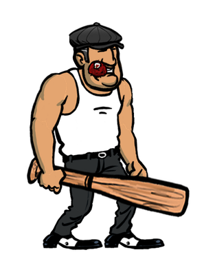 | **棒球棍打手** | Baseball Bat Gangster | 近战黑帮 | `Goon1` | 23 | 21 |
| 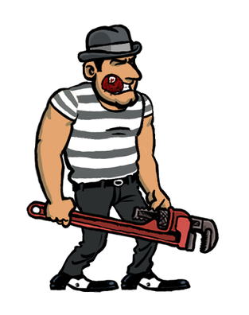 | **管钳打手** | Pipe Wrench Goon | 近战黑帮 | `Goon2` | 23 | 21 |
|  | **铁盾打手** | Shield Goon | 重装近战 | `Goon3` | 23 | 21 |
|  | **维托** | Vito | 家族干部 / 精英枪手 | `Vito` | 31 | 29 |
|  | **萨尔瓦托雷** | Salvatore | 家族干部 / 剧情角色 | `Salvatore` | 26 | 23 |
|  | **保利** | Paulie | 家族干部 / 精英枪手 | `Paulie` | 31 | 29 |
| 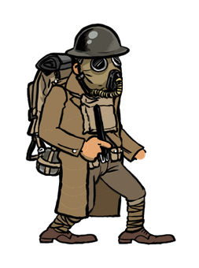 | **美军正规军士兵** | US Army Soldier | 军人敌人 | `Soldier` | 32 | 30 |
|  | **德国科学家** | German Scientist | 剧情 Boss / 关键 NPC | `Scientist` | 27 | 25 |

## 僵尸（ZOMBIE）

| 形象 | 中文名 | 英文名 | 类型 | 预制体 | 部件 | 贴图 |
| :--- | :--- | :--- | :--- | :--- | ---: | ---: |
| 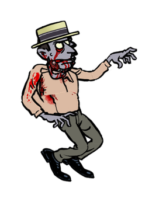 | **普通平民丧尸** | Civilian Zombie | 基础丧尸 | `ZombieRegular` | 29 | 27 |
|  | **平民丧尸·白衬衫** | Civilian Zombie (Runner) | 奔跑丧尸 | `ZombieRunner1` | 22 | 20 |
|  | **平民丧尸·黑西装** | Civilian Zombie (Suit Runner) | 奔跑丧尸 | `ZombieRunner2` | 22 | 20 |
| 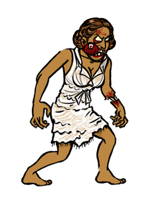 | **平民丧尸·白裙女子** | Civilian Zombie (Female Runner) | 奔跑丧尸 | `ZombieRunner3` | 20 | 19 |
| 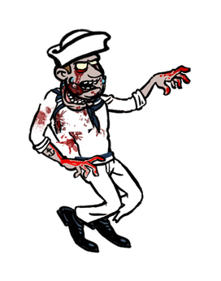 | **水手丧尸** | Sailor Zombie | 平民丧尸（水手） | `ZombieSailor` | 29 | 27 |
| 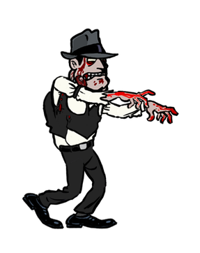 | **保利丧尸** | Paulie Zombie | 平民丧尸（黑帮） | `ZombiePaulie` | 29 | 27 |
| 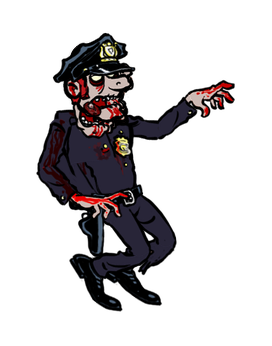 | **警察丧尸** | Cop Zombie | 平民丧尸（警察） | `ZombieCop` | 30 | 28 |
| 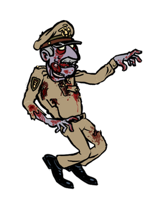 | **军官丧尸** | Officer Zombie | 平民丧尸（军官） | `ZombieOfficer` | 29 | 27 |
| 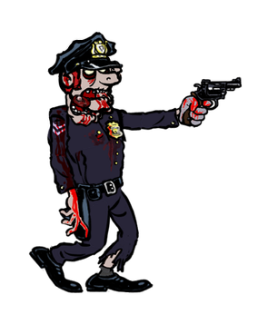 | **持枪丧尸** | Armed Zombie | 远程丧尸 | `ZombieGun` | 30 | 28 |
| 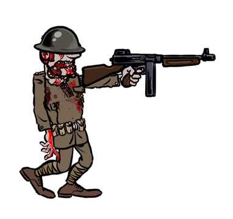 | **士兵丧尸** | Soldier Zombie | 武装丧尸 | `ZombieSoldier` | 33 | 31 |
| 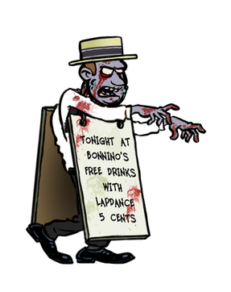 | **三明治人丧尸** | Sandwich Man Zombie | 防御型丧尸 | `ZombieSandwichBoard` | 31 | 28 |
| 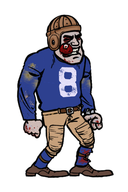 | **橄榄球手丧尸** | Football Player Zombie | 冲锋型丧尸 | `ZombieCharger` | 23 | 21 |
| 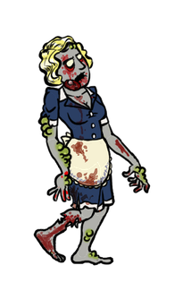 | **打嗝女丧尸** | Burping Maid Zombie | 远程毒气丧尸 | `ZombieBurping` | 19 | 19 |
| 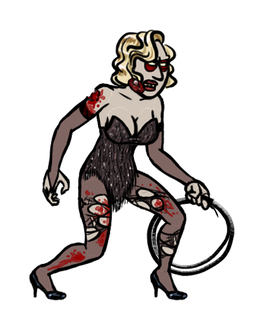 | **脱衣舞女丧尸** | Stripper Zombie | 近战丧尸（鞭） | `ZombieStripper` | 21 | 19 |
| 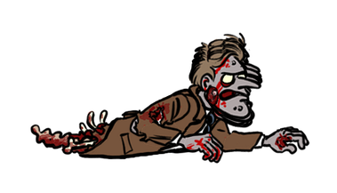 | **爬行丧尸** | Creeping Zombie | 矮体/残缺丧尸 | `ZombieCrawler` | 21 | 21 |
| 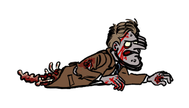 | **扑跳爬行丧尸** | Leaping Crawler | 矮体/突进丧尸 | `ZombieJumper` | 20 | 20 |
| 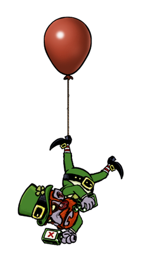 | **气球浮尸丧尸** | Balloon Floater Zombie | 特殊演出丧尸 | `ZombieFloater` | 19 | 14 |
| 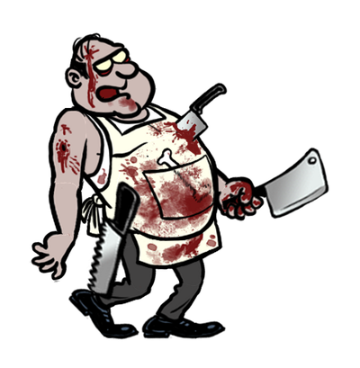 | **屠夫丧尸** | Butcher Zombie | 重型近战丧尸 | `FatCook` | 25 | 24 |
| 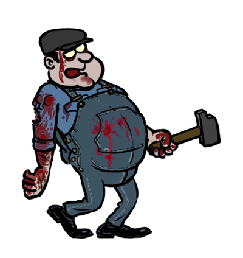 | **码头工丧尸** | Dockworker Zombie | 重型近战丧尸 | `FatDockworker` | 20 | 19 |

## 鼠怪（RODENT）

| 形象 | 中文名 | 英文名 | 类型 | 预制体 | 部件 | 贴图 |
| :--- | :--- | :--- | :--- | :--- | ---: | ---: |
| 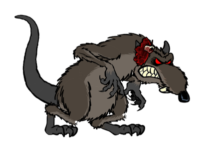 | **普通变异老鼠** | Medium Rat | 敏捷变异物 | `ZombieRat` | 32 | 26 |
| 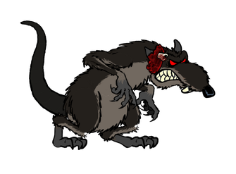 | **扑咬巨鼠** | Leaping Rat | 敏捷变异物（突进） | `ZombieRatJumper` | 32 | 26 |
| 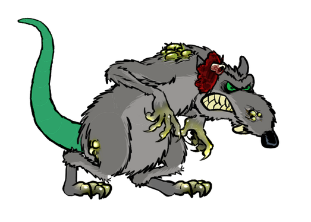 | **毒液巨鼠** | Big Poisonous Rat | 毒性变异物 | `ZombieRatSpitter` | 32 | 26 |

## Boss（BOSS）

| 形象 | 中文名 | 英文名 | 类型 | 预制体 | 部件 | 贴图 |
| :--- | :--- | :--- | :--- | :--- | ---: | ---: |
|  | **桑尼·波尼诺** | Sonny Bonnino | 第一关 Boss | `BonninoBoss` | 19 | 16 |
|  | **飞人法兰琪** | Frankie the Fly | 最终 Boss | `Frankie` | 31 | 28 |
|  | **暗黑教父** | The Dark Don | 最终 Boss（过场形态） | `EvilFrankie` | 0 | 0 |
|  | **暗黑教父·倒地** | The Dark Don (downed) | 最终 Boss（倒地演出） | `EvilFrankieOnFloor` | 31 | 28 |
| 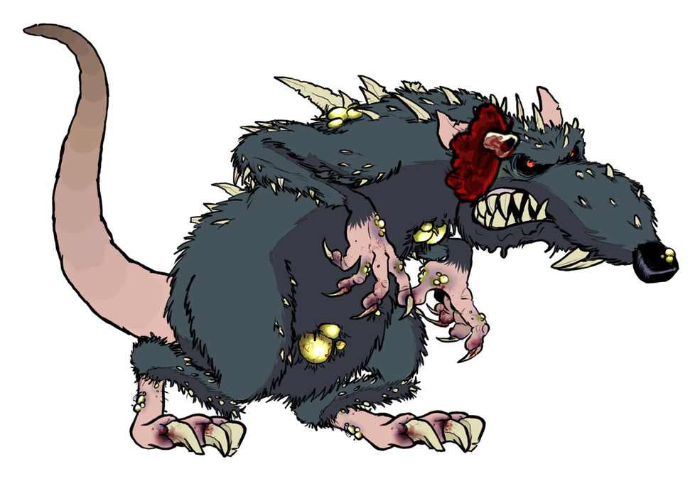 | **鼠王米基** | Mickey the Rat | 第二关 Boss | `ZombieRatBoss` | 32 | 26 |
